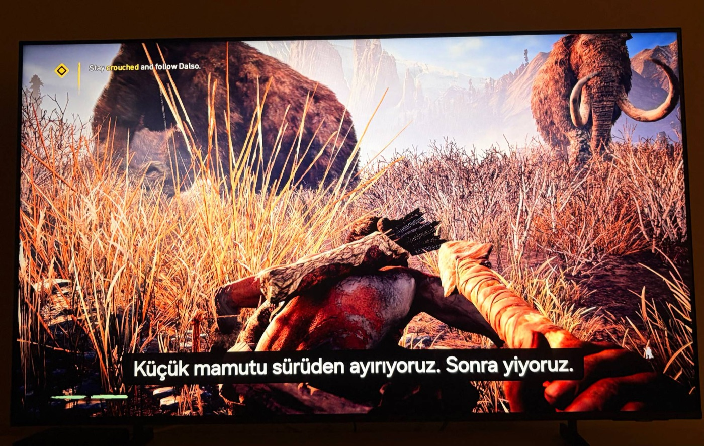
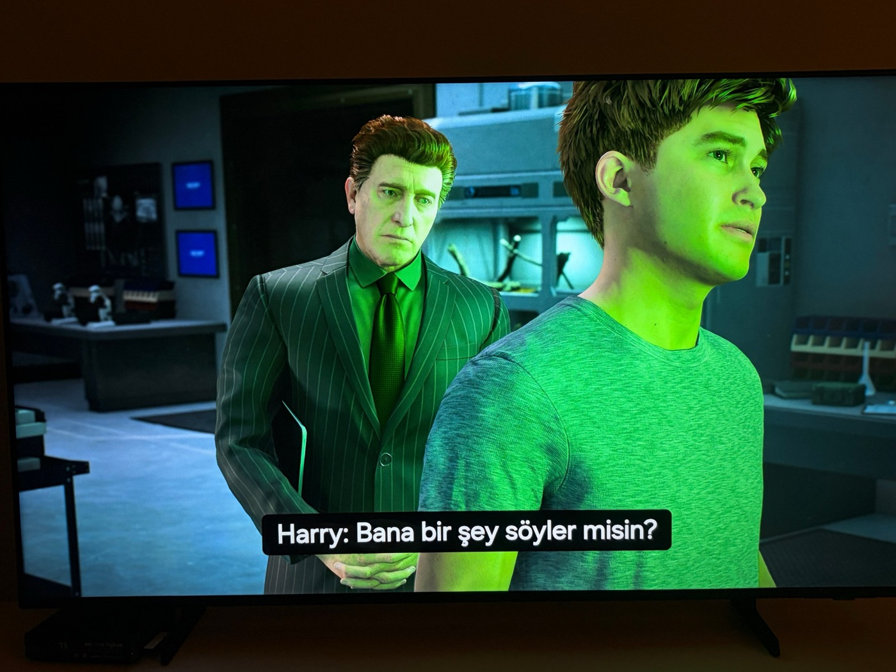
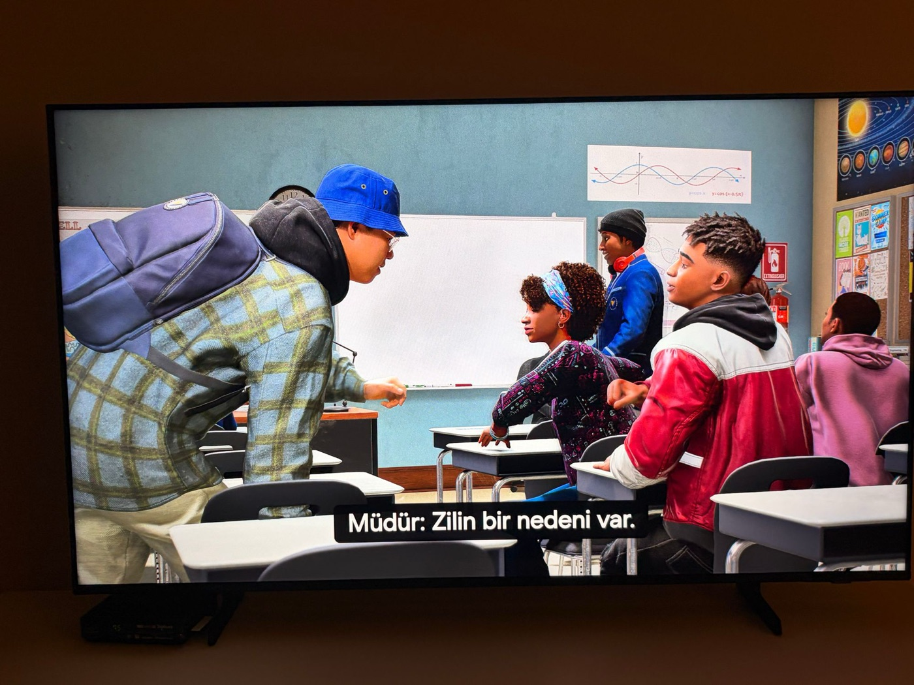
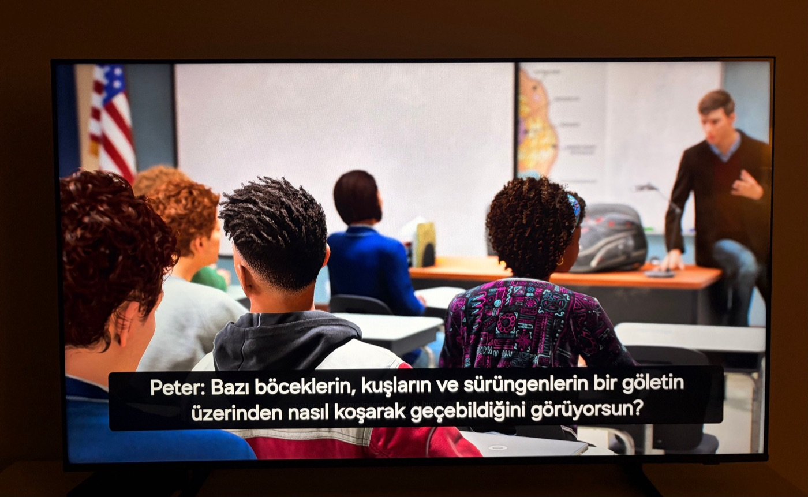
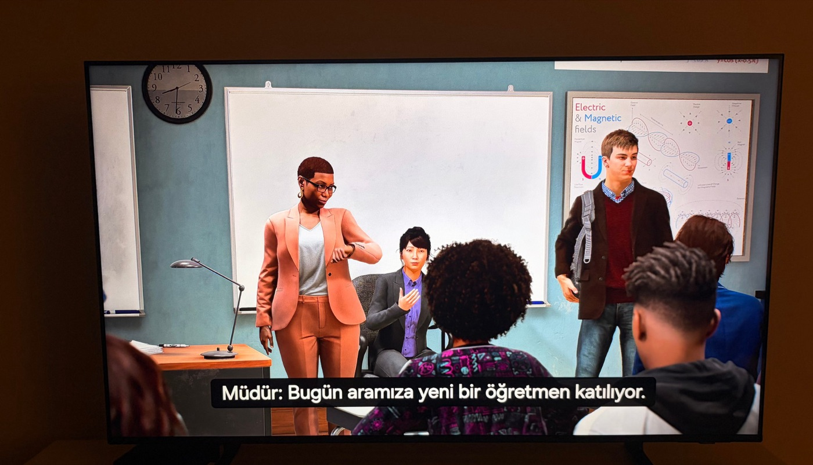
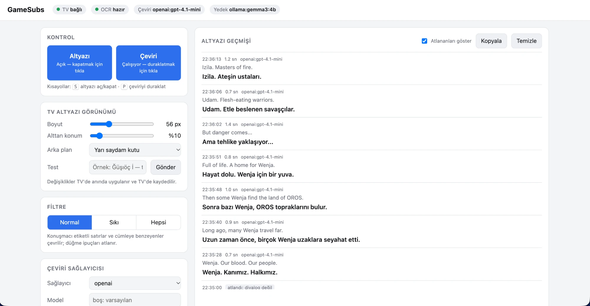

# GameSubs

PS5 oyunlarındaki **İngilizce altyazıları canlı olarak Türkçeye çevirip** Samsung TV'de oyun görüntüsünün **üzerine** yansıtan kişisel bir proje.

Ticari bir ürün değil; kendi evimde, kendi donanımımda kullanmak için geliştirdim.

**En önemlisi de GTA VI için yazıldı! 😉**



> Resmî bir Samsung, Sony, OpenAI, Anthropic veya Google ürünü değildir; bu firmalarla bağlantısı yoktur. Kişisel kullanım için yazıldı ve **deneysel** durumdadır (bkz. [Durum](#durum)).

## Ekran görüntüleri

Gerçek TV'de (Samsung UE55M80HAUXTK), PS5'te oynanırken. Türkçe altyazı oyunun İngilizce altyazısının üstüne basılıyor. Yukarıdaki Far Cry Primal görüntüsünde etiketsiz diyalog çevriliyor, sol üstteki görev ipucu ise bilerek çevrilmiyor.

| | |
|---|---|
|  |  |
| Konuşmacı etiketli diyalog (Spider-Man) | Opak kutu İngilizce altyazıyı kapatıyor |
|  |  |
| Uzun cümle, yarı saydam kutu (arkada İngilizce hafif görünüyor) | Konuşmacı adı da çevriliyor (Principal → Müdür) |

Mac kontrol paneli: altyazıyı aç/kapat, çeviriyi duraklat, TV görünümü, filtre, sağlayıcı ve canlı altyazı geçmişi.



> Oyun görüntüleri yalnızca projenin çalışmasını göstermek içindir; oyunların hakları sahiplerine aittir.

## Nasıl çalışır?

```
PS5 ──(HDMI)──────────────────► Samsung TV   oyun görüntüsü + Türkçe altyazı (Tizen uygulaması)
 │                                  ▲
 └─(PS Remote Play)─► Mac ──────────┘         OCR → çeviri → WebSocket
```

- **TV uygulaması (`src/`, TypeScript):** Samsung Tizen web uygulaması. `tizen.tvwindow` ile HDMI girişini uygulamanın **arkasında** gösterir (`show(..., 'MAIN', 'BEHIND')`), şeffaf HTML katmanıyla Türkçe altyazıyı üstüne basar. TV uygulaması ekrandaki yazıyı okuyamaz; bu yüzden OCR Mac'tedir.
- **Mac tarafı (`mac/ocr`, `tools/bridge.mjs`):** PS Remote Play penceresini yakalar, altyazıyı Apple Vision ile okur, çevirir (yerel ya da bulut modeli) ve TV'ye WebSocket ile yollar.
- **Mac paneli (`tools/panel`):** tarayıcıdan altyazıyı aç/kapat, çeviriyi duraklat, TV görünümünü ve sağlayıcıyı değiştir, canlı altyazı geçmişini gör.

## Gereksinimler

- Samsung TV (Tizen), geliştirici modu açık ve **Samsung sertifikası** (kendi hesabınla, TV'nin DUID'siyle). Denendiği tek model: UE55M80HAUXTK.
- Apple Silicon Mac (macOS), Node 22, Swift (Command Line Tools), PS Remote Play uygulaması.
- Çeviri için bir sağlayıcı: yerel **Ollama** veya **LM Studio** (anahtarsız), ya da **OpenAI, Anthropic (Claude), Google Gemini, OpenRouter, Groq, DeepSeek, Mistral** veya herhangi bir OpenAI uyumlu sunucu. Tablo: [docs/MAC-CEVIRI.md](docs/MAC-CEVIRI.md#çeviri-sağlayıcıları).

## Hızlı başlangıç

```bash
npm install
npm run typecheck

# 1) TV uygulaması: Mac'in IP'sini gömerek derle, imzala, TV'ye yükle
GAMESUBS_WS_URL=ws://<MAC_IP>:8765 npm run build        # → dist/
#   imzalama ve yükleme adımları: docs/KURULUM-TV.md

# 2) Mac tarafı: OCR + çeviri + köprü
export OPENAI_API_KEY="..."        # ya da ANTHROPIC_API_KEY, GROQ_API_KEY…; hiçbiri yoksa yerel Ollama. Anahtarı dosyaya yazma.
npm run start                      # başka sağlayıcı: npm run start -- --provider groq --model <kimlik>
npm run panel                      # Mac kontrol paneli: http://localhost:8766
```

Ayrıntılar: [Mac tarafı](docs/MAC-CEVIRI.md) · [Samsung TV kurulum rehberi](docs/KURULUM-TV.md).

## TV uyumluluğu

| Parça | Uyumluluk |
|---|---|
| Mac tarafı (OCR, çeviri, köprü) | TV'den bağımsız |
| TV uygulaması | **Yalnızca Samsung (Tizen)**. Başka Samsung modelleri muhtemelen çalışır ama denenmedi. LG/Sony/Android TV için yeniden yazım gerekir ve HDMI üstüne yazı basmaya izin verip vermedikleri araştırılmadı. |

## Kumanda (TV uygulaması)

▲▼ seç, ◄► değer değiştir, Enter uygula. Menü: kaynak seç/tara, "Kaynağı uygula + BEHIND", gizle, altyazı görünürlüğü/boyutu/arka planı (yok, yarı saydam, opak kutu)/konumu, test desenleri, tanılama, log paneli, paneli gizle. WebSocket durumu ve hatalar sağ üstte kısa bildirim olarak görünür.

## Durum

**Gerçek donanımda çalıştı** (Samsung UE55M80HAUXTK, Apple Silicon Mac, PS5; Spider-Man ve Far Cry Primal):
- TV uygulaması PS5'in HDMI görüntüsünü gösteriyor, Türkçe altyazı görüntünün üstünde çiziliyor.
- Remote Play → OCR → çeviri → TV zinciri canlı oyunda çalışıyor.
- Ölçülen (Mac): yakalama ~60 ms, OCR ~50–120 ms; yerel `gemma3:4b` ile çeviri ~1,3–2,7 sn (ilk kelime ~0,5–0,8 sn).

**Doğrulanmadı:**
- Uygulama açıkken HDR, oyun modu/VRR, görüntü kalitesi ve giriş gecikmesi (TV'de elle test edilmeli; web uygulaması bunları ölçemez).
- Başka Samsung modelleri ve yukarıdakiler dışındaki oyunlar.
- Bulut sağlayıcıların gecikmesi ve maliyeti; listelenen sağlayıcıların bir kısmı hiç denenmedi ([tablo](docs/MAC-CEVIRI.md#çeviri-sağlayıcıları)).

**Bilinen sınırlar:**
- Altyazı biçimine göre filtre: düğme ipuçları atılır; `Ad: metin` ve cümleye benzeyen satırlar çevrilir (`--strict` / `--all` ile ayarlanır). Oyuna göre altyazı bölgesi (`--region`) ayarı gerekebilir.
- İki satırlı altyazıda OCR satır sırası bazen bozulur.
- Mac veya TV'nin IP'si değişirse TV uygulaması yeniden derlenip yüklenmeli (sabit IP önerilir).
- Mac tarafı yalnızca macOS'ta çalışır (ScreenCaptureKit, Apple Vision).

## Güvenlik ve gizlilik

- API anahtarları yalnızca ortam değişkenlerinden okunur; dosyaya veya günlüğe yazılmaz.
- Bulut sağlayıcı kullanılırsa **yalnızca OCR ile okunan altyazı metni** gönderilir (görüntü gitmez). Yerel modelle (Ollama, LM Studio) hiçbir şey ağdan çıkmaz.
- Sertifikalar (`*.p12`), imzalı paketler ve ekran görüntüleri depoya girmesin diye `.gitignore`'dadır.

## Proje yapısı

```
src/        TV uygulaması (TypeScript: TVWindow, kaynaklar, altyazı, WebSocket, tanılama)
static/     config.xml, index.html, style.css
scripts/    build.mjs (esbuild + ikon), start.sh (Mac tarafı başlatıcı)
mac/ocr/    Swift OCR aracı (ScreenCaptureKit + Vision)
tools/      bridge.mjs (OCR → çeviri → WS), providers/ (çeviri sağlayıcıları), panel/ (Mac paneli), mock-server.mjs (sahte altyazı)
docs/       Samsung TV kurulumu (KURULUM-TV.md), Mac tarafı (MAC-CEVIRI.md)
```

WS mesajları (Mac → TV): `{"type":"subtitle","text":"…","ttlMs":3000}` · `{"type":"clear"}` · `{"type":"config","subtitle":{"visible":false}}` · düz metin. TV → Mac: `{"type":"tvstate","subtitle":{…}}`.
