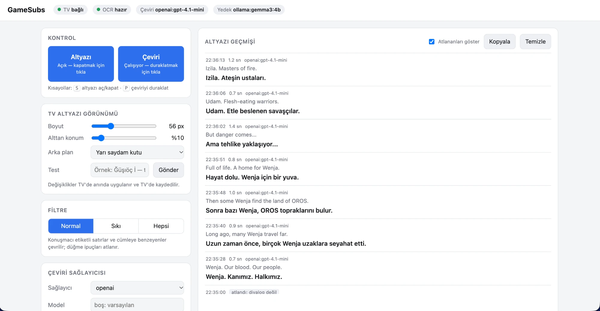

# Mac tarafı: OCR + çeviri + köprü

Akış: **PS5 → (HDMI) → TV** ve **PS5 → (Remote Play) → Mac → OCR → çeviri → WebSocket → TV overlay**.

## Gereksinimler
- Mac'te **PS Remote Play** uygulaması açık, PS5'e bağlı ve penceresi **görünür** (simge durumuna küçültülmemiş). Oyun TV'de normal oynanır; Remote Play yalnızca kopya görüntü verir.
- Terminal uygulamasına **Ekran ve Sistem Ses Kaydı** izni (Sistem Ayarları → Gizlilik ve Güvenlik).
- Swift (Command Line Tools yeterli), Node 22.
- Çeviri için bir sağlayıcı (aşağıdaki tablo). Anahtarı dosyaya ya da sohbete yazma; terminalde ortam değişkeni olarak ayarla.

## Çeviri sağlayıcıları

| `--provider` | Anahtar (ortam değişkeni) | Varsayılan model | Not |
|---|---|---|---|
| `ollama` | — | `gemma3:4b` | Yerel, internetsiz. `ollama pull gemma3:4b` |
| `openai` | `OPENAI_API_KEY` | `gpt-4.1-mini` | ChatGPT aboneliği API yerine geçmez |
| `anthropic` | `ANTHROPIC_API_KEY` (ya da `ant auth login`) | `claude-opus-5-5` | Resmî SDK; düşük `effort` ve reddetme yedeği açık. Daha hızlı/ucuz için `--model claude-haiku-5-5` |
| `gemini` | `GEMINI_API_KEY` | — (`--model` gerekli) | Google'ın OpenAI uyumlu ucu |
| `openrouter` | `OPENROUTER_API_KEY` | — | Yüzlerce modele tek anahtarla erişim |
| `groq` | `GROQ_API_KEY` | — | Çok hızlı çıkarım |
| `deepseek` | `DEEPSEEK_API_KEY` | — | |
| `mistral` | `MISTRAL_API_KEY` | — | |
| `lmstudio` | — | — | Yerel LM Studio sunucusu (`localhost:1234`) |
| `custom` | `GAMESUBS_API_KEY` (isteğe bağlı) | — | `--base-url` ile herhangi bir OpenAI uyumlu sunucu |

- Sağlayıcı verilmezse: `OPENAI_API_KEY` varsa `openai`, yoksa `ANTHROPIC_API_KEY` varsa `anthropic`, yoksa yerel `ollama`.
- Model kimliklerini görmek için: `npm run start -- --provider groq --list-models`.
- Bulut sağlayıcı art arda hata verirse (anahtar, bakiye, internet) Ollama çalışıyorsa yerel modele düşülür.
- Aynı ayarlar ortam değişkeniyle de verilebilir: `GAMESUBS_PROVIDER`, `GAMESUBS_MODEL`, `GAMESUBS_BASE_URL`.
- **Denenme durumu:** `ollama` ve OpenAI uyumlu kod yolu gerçek çeviriyle, `openai` (`gpt-4.1-mini`) oyunda denendi. `anthropic` yalnızca bağlantı/kimlik doğrulama hatası yolunda denendi. `gemini`, `openrouter`, `groq`, `deepseek`, `mistral`, `lmstudio` **denenmedi**; sorun çıkarsa `--base-url` ile adresi düzeltebilirsin.
- Yeni bir OpenAI uyumlu servis eklemek: `tools/providers/index.mjs` içindeki `PRESETS`'e bir satır.

Örnekler:
```bash
export GROQ_API_KEY="..."
npm run start -- --provider groq --list-models
npm run start -- --provider groq --model <listeden-kimlik>

npm run start -- --provider lmstudio --model <yüklü-model>
npm run start -- --provider custom --base-url http://localhost:8000/v1 --model <kimlik>
```

## Çalıştırma
```bash
cd ~/Desktop/ceviri
export OPENAI_API_KEY="..."     # ya da başka bir sağlayıcının anahtarı; hiçbiri yoksa yerel Ollama
npm run start                   # = scripts/start.sh; seçenekler: npm run start -- --provider … --model …
```
`scripts/start.sh`: çalışan köprü varsa reddeder (iki OCR süreci aynı pencereyi yakalayamaz), sahipsiz `gl-ocr` süreçlerini temizler, gerekirse `gl-ocr`'ı derler ve köprüyü başlatır. Köprü seçenekleri: `--provider`, `--model`, `--base-url`, `--list-models`, `--strict` / `--all` (filtre), `--region 0.65,1.0` (okunan bölge, üstten alta oran), `--hold 600` (yarım cümle bekleme, ms).
İlk açılışta OCR modeli ısınır (birkaç sn–1 dk). `OCR durum: hazir` ve `TV bağlandı: …` satırlarını bekle.

**WebSocket adresi TV uygulamasına derleme sırasında gömülüdür** (`GAMESUBS_WS_URL`). Mac'in IP'si değişirse yeniden derle/imzala/yükle (bkz. [KURULUM-TV.md](KURULUM-TV.md)). Yönlendiricide Mac ve TV'ye sabit IP vermek bunu önler.

## Mac paneli
Köprü çalışırken tarayıcıda **http://localhost:8766** (ya da `npm run panel`):



- **Altyazı aç/kapat** (TV'de anında) ve **çeviriyi duraklat** (OCR çalışır, çeviri ve API ücreti durur). Kısayollar: `S`, `P`.
- **TV altyazı görünümü:** boyut, alttan konum, arka plan (yok / yarı saydam / opak), test altyazısı. TV'nin kendi menüsüyle iki yönlü senkron; ayarlar TV'de kaydedilir.
- **Filtre:** Normal / Sıkı / Hepsi.
- **Çeviri sağlayıcısı ve modeli:** köprüyü yeniden başlatmadan değiştirilir (anahtarlar köprüyü başlattığın terminalden okunur).
- **Altyazı geçmişi:** İngilizce → Türkçe, saat, süre ve sağlayıcıyla canlı liste (son 300). Atlanan satırlar isteğe bağlı gösterilir; "Kopyala" ile tümü panoya.

Panel yalnızca bu Mac'ten açılır (`127.0.0.1`); ağdaki başka cihazlar ve tarayıcıda açık başka siteler bağlanamaz. Kapatmak için `--no-panel`, başka port için `--panel-port <n>`.

## Ne yapar
1. `gl-ocr` Remote Play penceresinin yalnızca alt bölgesini ~8 fps yakalar; görüntü değişmediyse OCR'ı atlar (tam çözünürlükte seyrek örnekleme, tek harflik değişimi de yakalar), değiştiyse Apple Vision ile okur, **en alttaki yazı kümesini** altyazı sayar, 2 karede aynı kalan metni "kararlı" ilan eder.
2. Köprü (`tools/bridge.mjs`): düğme ipuçlarını (`R2`, `L1`, `Triangle`…) atar; `Ad: metin` biçimli satırları ve etiketsiz ama cümleye benzeyen satırları (küçük harf içerir, `.` `!` `?` `…` ile biter, simgeyle başlamaz) çevirir; yalnızca etiketliler için `--strict`, her şey için `--all`; cümle sonu işareti yoksa 0,6 sn devam bekler ve yalnızca aynı konuşmacının küçük harfle başlayan devamını birleştirir; OCR'ın bozduğu konuşmacı gürültüsünü temizler.
3. Çeviri akışla TV'ye gider (kelime kelime). Türkçe altyazı okuma süresi kadar (2,5–7 sn) kalır; orijinal kaybolsa da çeviri iptal edilmez.
4. Bulut sağlayıcı 3 kez hata verirse yerel modele düşülür.
5. OCR aracı durursa (Remote Play penceresi kapandı/yeniden açıldı, ekran yakalama 3 sn cevap vermedi) köprü onu otomatik yeniden başlatır ve pencereyi yeniden arar.

## Hız ölçümü
```bash
build/gl-ocr --app RemotePlay --bench 40                              # varsayılan: yalnız bölge + değişmeyen kareyi atla
build/gl-ocr --app RemotePlay --bench 40 --full-capture --no-skip     # karşılaştırma: tüm pencere, her kare OCR
```
Köprü çalışırken çalıştırma (aynı pencereyi iki süreç yakalayamaz).

## Sorun giderme
| Belirti | Neden / çözüm |
|---|---|
| `Köprü zaten çalışıyor` | Başka terminalde köprü açık; orada Ctrl+C |
| `yakalama 3 sn içinde cevap vermedi`, `OCR aracı durdu` | Remote Play penceresi kapalı, küçültülmüş ya da başka bir masaüstünde; pencereyi görünür yap. Köprü kendisi yeniden dener |
| `pencere bulunamadı` | Remote Play kapalı/küçültülmüş; `build/gl-ocr --list` ile pencereyi gör |
| `Ekran kaydı izni yok` | Terminal uygulamasına izin ver, uygulamayı yeniden aç |
| `(atlandı: diyalog değil)` satırları, çeviri yok | Satır noktalamasız olabilir → `npm run start -- --all` |
| İpuçları/menüler çevriliyor | `npm run start -- --strict` (yalnızca `Ad:` etiketli satırlar) |
| OCR aracı derlenmemiş / eski | `npm run build:ocr` |
| Çeviri yok ama her şey çalışıyor görünüyor | Remote Play penceresinde gerçekten oyun mu var? PS5 menüde/ağ ayarındaysa çevrilecek altyazı yoktur |
